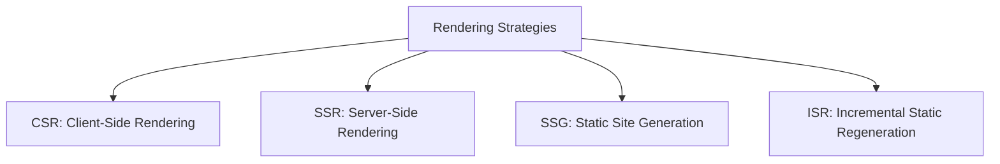

# 🚀 Next.js Master Interview Preparation Guide
> **Role:** MERN / Full Stack Developer (Next.js Focus)  
> **Target:** 1–3 Years Experience (Interview Ready)  
> **Key Focus:** Rendering Techniques (SSR, SSG, ISR, CSR), Server vs Client Components, App Router vs Pages Router, Routing, Caching & Performance.

---

## 📌 Table of Contents
1. [Next.js vs React.js (Kyu Next.js banaya gaya?)](#1-nextjs-vs-reactjs-the-fundamental-why)
2. [Rendering Strategies: CSR vs SSR vs SSG vs ISR ⭐⭐⭐](#2-rendering-strategies-csr-vs-ssr-vs-ssg-vs-isr)
3. [Server Components vs Client Components (`'use client'`) ⭐⭐⭐](#3-server-components-vs-client-components)
4. [App Router vs Pages Router (Architecture Shift)](#4-app-router-vs-pages-router)
5. [File-Based Routing & Dynamic Routes (`[id]`, `[...slug]`)](#5-file-based-routing--dynamic-routes)
6. [Data Fetching & Caching in App Router (`fetch` caching)](#6-data-fetching--caching-in-app-router)
7. [Inbuilt Optimizations: Image, Font, Link (`next/image`)](#7-inbuilt-optimizations)
8. [Middleware in Next.js (Auth & RBAC Protection)](#8-middleware-in-nextjs)
9. [Top 10 Rapid-Fire Next.js Interview Questions & Answers](#9-top-10-rapid-fire-interview-qa)

---

## 1. Next.js vs React.js (The Fundamental "Why?")

| Feature | React.js | Next.js |
| :--- | :--- | :--- |
| **Type** | JavaScript **Library** for building UI | Full-stack **Framework** built on top of React |
| **Rendering** | Pure **CSR (Client-Side Rendering)** | **Hybrid:** SSR, SSG, ISR, aur CSR sab support karta hai |
| **SEO (Search Engine Optimization)** | **Poor** (Kyunki initial HTML blank `div id="root"` hoti hai) | **Excellent** (Server pe pre-rendered HTML banti hai) |
| **Routing** | Manual (needs `react-router-dom`) | Inbuilt **File-system based routing** |
| **Backend / API** | Sirf frontend (Alag se Express chahiye) | Inbuilt **API Routes / Route Handlers** (`/api/`) |
| **Performance** | Manual code-splitting & optimization | Automatic Image/Font optimization & Code splitting |

> 🎯 **Interview Answer:** *"React ek client-side UI library hai jisme blank HTML browser me aati hai aur JS download hone ke baad page render hota hai (Poor SEO & initial load). Next.js ek full-stack React framework hai jo Server-Side Rendering (SSR) aur Static Site Generation (SSG) provide karta hai, jisse SEO super-strong hota hai aur first page load ultra-fast hota hai bina alag se routing library lagaye."*

---

## 2. Rendering Strategies: CSR vs SSR vs SSG vs ISR ⭐⭐⭐
*(Yeh sawaal har Next.js interview me 100% aata hai!)*



### 1. CSR (Client-Side Rendering)
* **Kab render hota hai?** Browser me (Client par).
* **Working:** Server se blank HTML aur JS aati hai. Browser JS chala kar UI render karta hai.
* **Kab use karein?** Private dashboards, admin panels jahan SEO ki zaroorat nahi hai.

### 2. SSR (Server-Side Rendering)
* **Kab render hota hai?** **Har user request par server par!**
* **Working:** Jab bhi koi page reload karega, server fresh HTML page bana kar browser ko bhejega.
* **Kab use karein?** Jahan data har second change hota ho aur SEO zaroori ho (e.g., Stock market prices, Live cricket score, Social media feed).
* *(Pages Router me: `getServerSideProps`, App Router me: `fetch(url, { cache: 'no-store' })`).*

### 3. SSG (Static Site Generation)
* **Kab render hota hai?** **Build Time par (Jab project build hota hai `npm run build`)!**
* **Working:** Saare HTML pages pehle se hi generate hoke server par static files ki tarah save ho jaate hain. CDN se super-fast deliver hote hain.
* **Kab use karein?** Blogs, Documentation, Landing Pages, About Us jahan data bar-bar nahi badalta.
* *(Pages Router me: `getStaticProps`, App Router me: default `fetch(url)`).*

### 4. ISR (Incremental Static Regeneration) ⭐ (Next.js Killer Feature)
* **Problem with SSG:** Agar build hone ke baad data badal gaya, toh poora project dobara build karna padta tha.
* **ISR Solution:** Page static hi rahega, lekin har **X seconds** ke baad background me regenerate ho jayega bina poora project rebuild kiye!
* **Kab use karein?** E-commerce product pages (jahan price din me 1-2 baar badalti hai).
* *(App Router code: `fetch(url, { next: { revalidate: 60 } })` -> har 60 second me fresh data).*

---

## 3. Server Components vs Client Components

Next.js 13+ (App Router) me by default **har component Server Component hota hai**!

| Feature | Server Component (Default) | Client Component (`'use client'`) |
| :--- | :--- | :--- |
| **Execution** | Sirf **Server** par chalta hai | Server par pre-render + **Browser** me execute |
| **Bundle Size** | **Zero JS bundle** (browser ko JS nahi bheji jaati) | Browser ko JS file download karni padti hai |
| **Direct DB Access**| ✅ Direct DB query / secret API keys chala sakte ho | ❌ Direct DB call nahi kar sakte (Security risk) |
| **Hooks & Events** | ❌ `useState`, `useEffect`, `onClick` use **NAHI kar sakte** | ✅ `useState`, `useEffect`, `onClick`, `onChange` sab chalega |

### `'use client'` Kab Lagana Hai?
File ke sabse top par `'use client'` sirf tab likhte hain jab:
1. User interaction handle karni ho (`onClick`, `onChange`, `onSubmit`).
2. React Hooks use karne hon (`useState`, `useEffect`, `useRef`).
3. Browser-only APIs use karni hon (`localStorage`, `window`, `document`).

```jsx
// ❌ Server Component (Default - No hooks allowed)
export default async function ProductPage() {
  const products = await db.query("SELECT * FROM products"); // Direct DB access!
  return <div>{products.map(p => <h1>{p.title}</h1>)}</div>;
}

// ✅ Client Component (Needs 'use client')
'use client';
import { useState } from 'react';

export default function LikeButton() {
  const [likes, setLikes] = useState(0);
  return <button onClick={() => setLikes(likes + 1)}>Like {likes}</button>;
}
```

---

## 4. App Router vs Pages Router

| Feature | Pages Router (Purana - Next 12) | App Router (Naya - Next 13/14/15) |
| :--- | :--- | :--- |
| **Directory** | `/pages` folder | `/app` folder |
| **Default Component**| Client Component | **Server Component** (Fast & Zero JS) |
| **Routing** | File name se route banta tha (`about.js` -> `/about`) | Folder name se route banta hai (`/about/page.js`) |
| **Layouts** | Complex `_app.js` aur `_document.js` | Nested `layout.js` (Root layout & sub layouts) |
| **Data Fetching** | `getServerSideProps`, `getStaticProps` | Standard `async/await` in Server components |

---

## 5. File-Based Routing & Dynamic Routes

App Router me folder structure hi URL banta hai:

```
app/
├── layout.js          -> Global Header/Footer (Root Layout)
├── page.js            -> Home Page ("/")
├── about/
│   └── page.js        -> About Page ("/about")
├── products/
│   ├── page.js        -> Products List ("/products")
│   └── [id]/
│       └── page.js    -> Single Product Details ("/products/101")
└── api/
    └── users/
        └── route.js   -> Backend API Endpoint ("/api/users")
```

### Dynamic Route Param Access:
```jsx
// app/products/[id]/page.js
export default function ProductDetail({ params }) {
  return <h1>Product ID: {params.id}</h1>;
}
```

---

## 6. Data Fetching & Caching in App Router

App Router me `fetch()` ko extend karke caching control di gayi hai:

```javascript
// 1. Static (SSG) - Default Cache (Never refetches unless re-built)
fetch('https://api.com/data'); 

// 2. Dynamic (SSR) - Har request par naya data (No-Store)
fetch('https://api.com/data', { cache: 'no-store' });

// 3. Revalidated (ISR) - Har 60 second baad background me refresh
fetch('https://api.com/data', { next: { revalidate: 60 } });
```

---

## 7. Inbuilt Optimizations

### 1. `next/image` vs ``
* **Automatic WebP Conversion:** Heavy PNG/JPEG ko modern lightweight WebP/AVIF format me convert karta hai.
* **Lazy Loading:** Image screen par scroll hone par hi download hoti hai.
* **Layout Shift Prevention:** Width aur height reserve rakhta hai taaki page hil na jaye (CLS zero karta hai).

### 2. `next/link` vs `<a>` tag
* `<a>` tag poora browser page reload karta hai.
* `<Link href="/about">` SPA (Single Page Application) ki tarah client-side navigate karta hai bina reload ke, aur **page ke code ko pehle se pre-fetch kar leta hai**!

---

## 8. Middleware in Next.js (Auth & RBAC)

Root level par `middleware.js` file hoti hai jo request complete hone se pehle execute hoti hai.

### Use Case: Protect Routes (Dashboard & Admin)
```javascript
// middleware.js
import { NextResponse } from 'next/server';

export function middleware(request) {
  const token = request.cookies.get('token')?.value;

  // Agar user ke paas token nahi hai aur wo dashboard ja raha hai:
  if (!token && request.nextUrl.pathname.startsWith('/dashboard')) {
    return NextResponse.redirect(new URL('/login', request.url));
  }

  return NextResponse.next();
}

// Sirf in routes par middleware chalega:
export const config = {
  matcher: ['/dashboard/:path*', '/admin/:path*'],
};
```

---

## 9. Top 10 Rapid-Fire Interview Q&A

1. **Q: Next.js me SEO kyu behtar hota hai React se?**  
   *A:* React me empty HTML aati hai jo search engine bots padh nahi paate. Next.js server par pre-rendered content-rich HTML bhejta hai jo Google bot turant index kar leta hai.

2. **Q: Kya Server Component ke andar Client Component daal sakte hain?**  
   *A:* Haan, bilkul daal sakte hain (jaise Server Page ke andar ek `<LikeButton />` Client component).

3. **Q: Kya Client Component ke andar Server Component direct import kar sakte hain?**  
   *A:* Direct import nahi kar sakte! Par usko as a `children` prop pass kar sakte hain.

4. **Q: `generateStaticParams` kya karta hai?**  
   *A:* Dynamic routes (`[id]`) ke liye build time par saare IDs ki static HTML pages pehle se generate kar deta hai (SSG for dynamic routes).

5. **Q: `next/font` ka kya fayda hai?**  
   *A:* Google fonts ko local server par download karke serve karta hai, external Google network request nahi bhejta (Zero layout shift & fast load).
